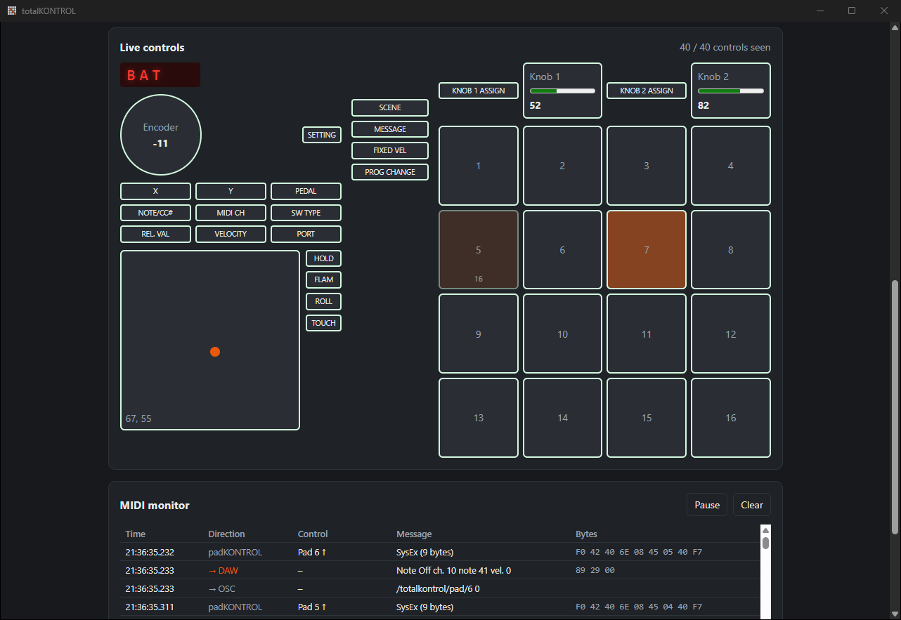
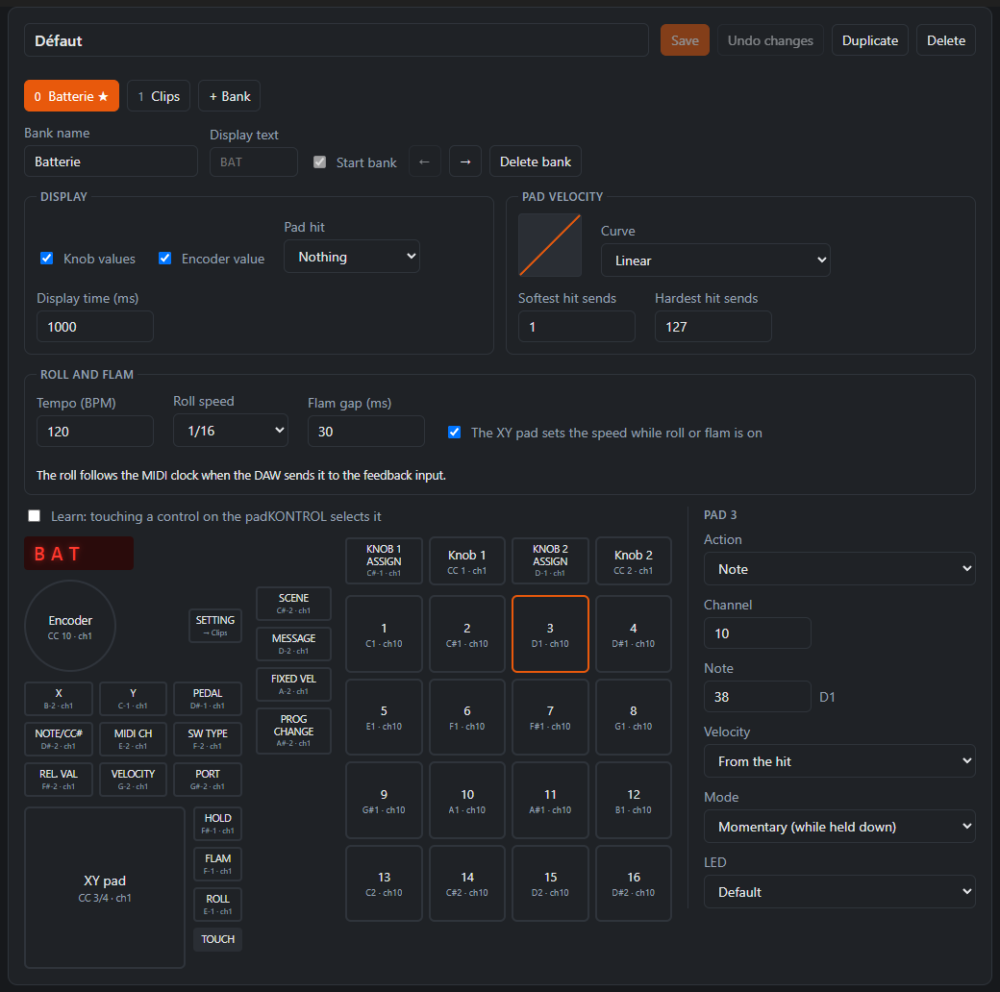

# totalKONTROL

Full control of the **Korg padKONTROL**, on Windows, macOS and Linux.

totalKONTROL puts the padKONTROL in its native mode and takes over every control: the 16 pads, the 19 buttons, both knobs, the XY pad and the encoder. It turns them into MIDI for your DAW or OSC for any other software, switches between banks, and drives the LEDs and the 3-character display.



## Features

- **Every control mapped**: notes, CCs, program changes, bank switches, OSC messages or keyboard shortcuts, per bank, in momentary or toggle mode.
- **Playing aids**: velocity curves, and the ROLL and FLAM buttons brought back to life, in time with the DAW's MIDI clock.
- **LEDs and display**: LEDs light on press, follow a toggle, or follow your DAW or OSC software; the display shows the bank, the knob and encoder values, and optionally the note or velocity of each pad hit.
- **Visual profile editor**: a picture of the padKONTROL to click on, a form per control, live validation, and a learn mode that selects the control you touch.
- **Live view and monitor**: see every control move, which LEDs are lit, and every message in and out.
- **OSC**: mirror every control to fixed addresses, send custom OSC messages, and receive OSC to drive the LEDs, the display and the banks.
- **Stays out of the way**: lives in the system tray, connects at startup, and reconnects when the padKONTROL is plugged back in.
- **English, French and Spanish**.

## Getting started

1. Install totalKONTROL from the [releases](https://github.com/PoUpA/totalKONTROL/releases), or [build it](#building-from-source).
2. Plug in the padKONTROL. On Windows, the Korg USB-MIDI driver (from [Korg's website](https://www.korg.com/)) is recommended.
3. Set up a MIDI port towards your DAW (see [Connecting to the DAW](#connecting-to-the-daw)).
4. In totalKONTROL, pick the padKONTROL ports, keep native mode on, pick the DAW ports and a profile, then click **Connect**.

The installers are not code-signed yet: Windows SmartScreen and macOS Gatekeeper warn on first launch.

## Using the app

### Connection

- **padKONTROL ports**: with the Korg driver on Windows, the controls arrive on `PORT A` and the padKONTROL listens for native mode on `CTRL`; `MIDI IN` and `MIDI OUT` are the DIN sockets on the back. The app preselects the right ports, and finds the padKONTROL's global MIDI channel by itself.
- **Native mode**: on, the app takes over every control and drives the LEDs and the display. Off, the padKONTROL plays its own scenes, and the app passes what it sends on to the DAW port.
- **DAW ports**: the port that carries messages to the DAW, and the port that brings messages back from the DAW for the LEDs in `follow` mode.
- **Profile**: the mapping to apply. Profiles can be switched, and banks selected, while connected.

Once connected, the display shows the bank and the LEDs follow the profile. The live view shows every control as it moves and the LEDs lit on the padKONTROL; the monitor lists each message with its direction. **All notes off**, in the connection card or the tray menu, ends every note left on in the DAW (All Notes Off and All Sound Off on every channel). Disconnecting, or closing the app, returns the padKONTROL to its normal mode.

If the padKONTROL is unplugged, the app ends the notes left on and waits for it. When it comes back, the app reconnects with the same settings and profile, on the same bank, with roll and flam as they were. **Connect at startup with these settings** connects as soon as the app opens.

Closing the window keeps the app running in the system tray, so the padKONTROL keeps working; quit from the tray icon's menu.

The language follows the system and can be changed from the header.

### Connecting to the DAW

- **macOS and Linux**: choose **Virtual port** in both DAW lists. The app creates the `totalKONTROL` and `totalKONTROL feedback` ports.
- **Windows with loopMIDI**: create two ports with [loopMIDI](https://www.tobias-erichsen.de/software/loopmidi.html), named `totalKONTROL` and `totalKONTROL feedback`; the app preselects them. In the DAW, enable `totalKONTROL` as an input and `totalKONTROL feedback` as an output.
- **Windows with Windows MIDI Services**: with the `winmidi` installer, on a Windows whose MIDI service is fixed, choose **Virtual port**. The app creates a single bidirectional `totalKONTROL` device: enable it as an input and as an output in the DAW. See [Windows MIDI Services](#windows-midi-services).

The feedback port must differ from the output port: a loopMIDI port echoes everything written to it, so messages would loop. The app refuses that setup.

### Profiles

A profile describes, bank by bank, what each control does:

- **Controls**: pads `1` to `16` (pad 1 top left), buttons (`setting`, `x`, `pedal`…), knobs `1` and `2`, the XY pad, touching the XY pad (`xyTouch`: an action on touch and release, like a button without an LED), and the encoder.
- **Actions**: `note`, `cc`, `programChange`, `switchBank`, `switchProfile` (makes another profile, by its file name, the active one), `osc`, `key`, `roll` or `flam`. Pads and buttons can be `momentary` or `toggle`, and their LED `none`, `press`, `toggle` or `follow` (driven by the DAW or by OSC).
- **Display**: each bank shows its `display` text, or the start of its name. When a knob turns, the display shows the value sent; when the encoder turns, its position: 0 to 127 in absolute mode, a free counter from -99 to 999 in relative mode, where the DAW only gets steps. The bank comes back after `display.duration` milliseconds. A pad hit can show its note or velocity (`display.pads`).
- **Knobs and encoder**: with `pickup`, a knob waits after a bank change until it reaches the value it had in that bank, so the target does not jump. With `acceleration`, the encoder moves up to four steps per detent when turned fast.
- **Velocity**: a `soft`, `linear` or `hard` curve, and the velocities sent for the softest and hardest hits (`velocity`). It shapes pad hits everywhere: notes, OSC `$velocity` and the display.
- **Keyboard shortcuts**: a `key` action types a shortcut such as `ctrl+shift+s` into the app in front, on press, or keeps its keys down while the control is held (`hold`). On the encoder, it types one shortcut per step to the left and another to the right. Names are separated by `+`: `ctrl`, `shift`, `alt`, `meta` (Windows or Command key), a character, `plus`, `minus`, `space`, `enter`, `tab`, `esc`, `backspace`, `delete`, `home`, `end`, `pageup`, `pagedown`, the arrows `up`, `down`, `left`, `right`, `f1` to `f20`, `num0` to `num9`, and the media keys `volumeup`, `volumedown`, `mute`, `playpause`, `next`, `previous`. In the editor, **Record** captures a shortcut from the keyboard. On macOS, allow totalKONTROL in System Settings › Privacy & Security › Accessibility; on Linux, shortcuts need an X11 session.
- **Roll and flam**: a `roll` action turns roll on or off: a held momentary pad repeats its note, at `repeat.roll` divisions of a whole note (16 for sixteenth notes). The tempo follows the MIDI clock when the DAW sends it to the feedback port, and `repeat.bpm` otherwise. A `flam` action turns flam on or off: each hit plays a softer grace note `repeat.flam` milliseconds before the note. While either is on, the X axis of the XY pad sets the speed or the gap (`repeat.xySpeed`). The default profile maps them to the ROLL and FLAM buttons.



Edit profiles in the **Profiles** tab, or by hand: they live in the app's config folder, under `profiles/`, next to a copy of the [JSON Schema](src-tauri/profiles/profile.schema.json), so an editor such as VS Code offers completion and flags errors. See the [default profile](src-tauri/profiles/default.json) for an example.

### OSC

Turn on **OSC output** in the connection card and set the host, port and address prefix (`/totalkontrol` by default).

- **Mirror**: every control goes to a fixed address, with or without a profile:
  - `<prefix>/pad/3 <velocity>` (0 on release)
  - `<prefix>/button/hold 1|0`
  - `<prefix>/knob/1 <0-127>`
  - `<prefix>/xy <x> <y>` and `<prefix>/xy/touch 1|0`
  - `<prefix>/encoder <step> [<position>]`
  - `<prefix>/bank <index>`

  Outside native mode, the padKONTROL plays its own scenes and the app does not know which control sent what: it mirrors their notes and CCs instead, as `<prefix>/note <channel> <note> <velocity>` (0 for a note off) and `<prefix>/cc <channel> <cc> <value>`.

- **`osc` actions** in profiles: pads and buttons send an address with arguments on press (`$velocity` stands for the velocity of the hit) and, optionally, other arguments on release; knobs send a value scaled to a range, as an integer or a float; the XY pad sends x and y; the encoder sends its step (relative) or its position (absolute).
- **Input**: turn on **Listen for OSC on port** (9001 by default) to drive the padKONTROL from your software. The app only accepts OSC from the same computer unless **Accept OSC from other devices on the network** is on, for a tablet for instance. It needs an active profile in native mode:
  - `<prefix>/led/pad/3 1|0` and `<prefix>/led/button/hold 1|0` set an LED until the next bank change;
  - `<prefix>/display "ABC"` writes on the display;
  - `<prefix>/bank 2` switches bank;
  - any other address drives the `follow` LEDs of the `osc` actions that send to it (lit when the first argument is not zero).

OSC messages show in the monitor as "→ OSC" (sent) and "← OSC" (received).

To try it, [tools/osc-led-demo.mjs](tools/osc-led-demo.mjs) plays a light show on the padKONTROL (a snake, rain, a wave, sparkles, a scanner) and sends a ripple from each pad you hit. Connect with a profile, turn on the OSC output (127.0.0.1:9000) and the OSC input (port 9001), then run:

```bash
npm run demo:osc
```

Ctrl+C turns the LEDs off; switch bank to hand them back to the profile. Options: `--host`, `--port`, `--listen` (0 turns the ripples off), `--prefix`, `--fps`, `--seconds`.

## Windows MIDI Services

On Windows, `midir` cannot create virtual MIDI ports. With the Windows MIDI Services (Windows 11 25H2 or later), the app can create its own MIDI device instead of relying on loopMIDI. This is built behind the `windows-midi-services` Cargo feature, which ships the `Windows.Devices.Midi2` API next to the executable.

Until the Windows update due at the end of November 2026, the Windows MIDI service has a bug ([microsoft/MIDI#1047](https://github.com/microsoft/MIDI/issues/1047)): creating a virtual device a second time after the service starts freezes the whole Windows MIDI stack, for every app. The app detects the buggy version and does not offer the virtual port until Windows is updated; use loopMIDI meanwhile. If the MIDI service is frozen anyway (no port shows up, the app reports that the service does not respond), close the MIDI apps and the DAW, run [scripts/restart-midisrv.ps1](scripts/restart-midisrv.ps1) in an administrator PowerShell, then click **Refresh**.

Details: [docs/windows-midi-services.md](docs/windows-midi-services.md).

## Building from source

Requirements:

- Node.js 20 or later
- Rust stable, through [rustup](https://rustup.rs)
- The [Tauri system requirements](https://tauri.app/start/prerequisites/) for your system

```bash
npm install
```

```bash
npm run tauri dev
```

Tests and lints for the Rust core:

```bash
cargo test --manifest-path src-tauri/Cargo.toml --lib
```

```bash
cargo clippy --manifest-path src-tauri/Cargo.toml --all-targets -- -D warnings
```

CI runs the frontend build, the Rust tests and clippy on Windows, macOS and Ubuntu ([ci.yml](.github/workflows/ci.yml)).

### Installers

```bash
npm run tauri build
```

The installers land in `src-tauri/target/release/bundle/`: `.msi` and NSIS `.exe` on Windows, `.dmg` and `.app` on macOS, `.deb`, `.rpm` and `.AppImage` on Linux. They are built without the `windows-midi-services` feature.

The Windows `winmidi` variant needs the `Windows.Devices.Midi2` package (about 103 MB, from Microsoft's GitHub releases, into `src-tauri/vendor/`, ignored by git). Because of that DLL's license, its installers refuse to run before Windows 11 25H2 (build 26200):

```bash
powershell -ExecutionPolicy Bypass -File scripts/fetch-windows-midi.ps1
```

```bash
npm run build:winmidi
```

It lands in the same folder under the same names: move the plain installers out first. To run the app with the feature during development, use `npm run dev:winmidi`.

### Releases

Pushing a version tag builds the installers for all three systems, both Windows variants included, and attaches them to a draft GitHub release to review and publish ([release.yml](.github/workflows/release.yml)):

```bash
git tag v0.1.0
```

```bash
git push origin v0.1.0
```

## Project layout

- `src-tauri/src`: the Rust core — padKONTROL protocol (`padkontrol.rs`), mapping engine (`engine.rs`), profiles (`config.rs`), MIDI and OSC connections (`midi.rs`, `osc.rs`), Windows virtual device (`winmidi.rs`), message lookup (`i18n.rs`)
- `src`: the React UI
- `locales`: the translations, one JSON file per language, shared by the UI and the Rust core (`core.*` keys). English is the reference; to add a language, copy `en.json`, translate it and register the language in `src/i18n/index.tsx` and `src-tauri/src/i18n.rs`. Tests check that every language has the same keys and placeholders.
- `src-tauri/profiles`: the profile JSON Schema and the default profile
- `docs`: [SysEx messages captured from the padKONTROL](docs/padkontrol-sysex.txt), [notes on Windows MIDI Services](docs/windows-midi-services.md) and the README screenshots
- `tools`: the OSC LED demo

The original Qt/C++ version of totalKONTROL is in the history, up to commit [`741dd18`](https://github.com/PoUpA/totalKONTROL/tree/741dd18e654c117ccad21254f3954ae552e8bd19).

## License

[MIT](LICENSE). The `Windows.Devices.Midi2` package used by the optional `windows-midi-services` build is Microsoft's and comes with its own license (see [docs/windows-midi-services.md](docs/windows-midi-services.md)).
